<div align="center">


# ACARS MCDU

**Terminal ACARS estilo cabina (MCDU) con mapa y parámetros de vuelo en vivo.**
Decodifica ACARS con un RTL-SDR vía `acarsdec`, correlaciona cada mensaje con el
avión real y lo muestra en un PFD y un mapa, todo en una sola ventana Qt.

[](../../releases/latest)
[](https://www.python.org/)
[](https://pypi.org/project/PyQt6/)
[](LICENSE)

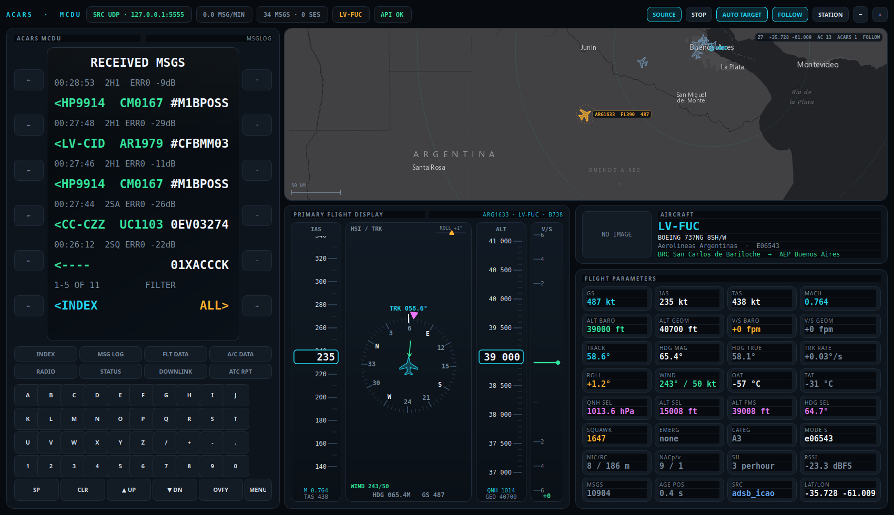

</div>

---

## Índice

- [Qué hace](#qué-hace)
- [Instalación](#instalación)
- [Fuentes de mensajes](#fuentes-de-mensajes)
- [La pantalla MCDU](#la-pantalla-mcdu)
- [Mapa](#mapa)
- [PFD y parámetros de vuelo](#pfd-y-parámetros-de-vuelo)
- [Teclas](#teclas)
- [Configuración](#configuración)
- [De dónde salen los datos](#de-dónde-salen-los-datos)
- [Construir el AppImage](#construir-el-appimage)
- [Estructura del proyecto](#estructura-del-proyecto)
- [Resolución de problemas](#resolución-de-problemas)

---

## Qué hace

Un RTL-SDR escuchando las frecuencias ACARS (131.550, 131.725, 130.025…) recibe
los mensajes que los aviones intercambian con sus aerolíneas: reportes de
posición, horarios OUT/OFF/ON/IN, pedidos de meteorología, mensajes de
mantenimiento. `acarsdec` los decodifica; esta app los presenta como lo haría la
computadora de a bordo y, además, **busca el avión que los mandó**:

```
mensaje ACARS  →  matrícula (.LV-CID)  →  adsbdb: tipo, operador, Mode S, ruta, foto
                                       →  adsb.lol: posición y estado en vivo
                                       →  mapa + PFD + 32 parámetros de vuelo
```

Todo corre en una ventana: el MCDU a la izquierda, el mapa arriba a la derecha y
el PFD con la grilla de parámetros abajo.

| | |
|---|---|
| 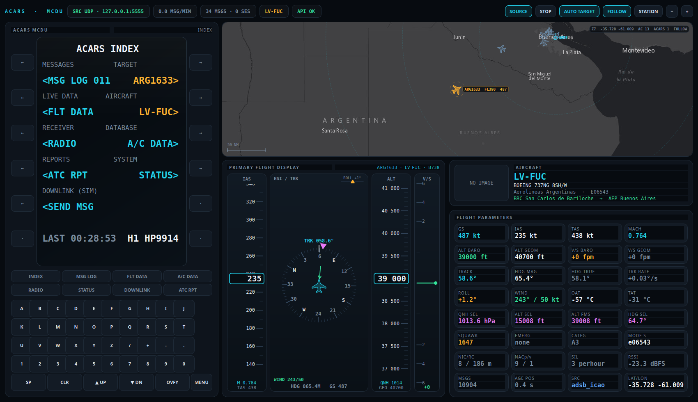 | 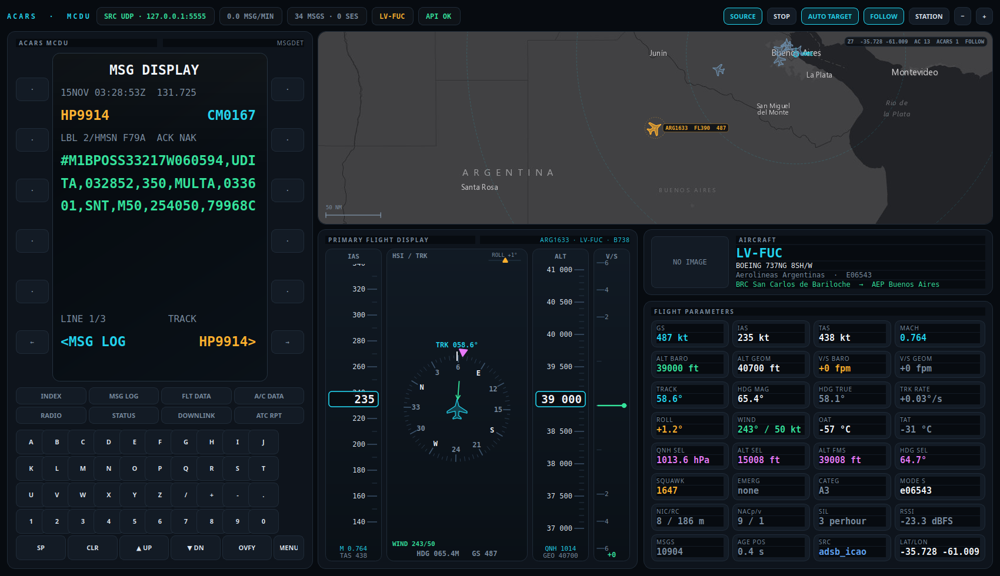 |
| **ACARS INDEX** — menú principal con contador de mensajes y objetivo actual | **MSG DISPLAY** — mensaje completo, con LSK6R para seguir al avión |

---

## Instalación

### AppImage (recomendado)

```bash
wget https://github.com/jeremiaspala/acars-mcdu/releases/latest/download/ACARS_MCDU-1.0.0-x86_64.AppImage
chmod +x ACARS_MCDU-1.0.0-x86_64.AppImage
./ACARS_MCDU-1.0.0-x86_64.AppImage
```

Trae Python y PyQt6 adentro (58 MB). **No** trae `acarsdec` ni `librtlsdr`: si
vas a usar el dongle local necesitás `acarsdec` en el PATH
([TLeconte/acarsdec](https://github.com/TLeconte/acarsdec)). Para las fuentes de
red, comando o simulador no hace falta nada más.

### Desde el código

```bash
git clone https://github.com/jeremiaspala/acars-mcdu
cd acars-mcdu
sudo apt install python3-pyqt6            # o: pip install PyQt6
./start.sh sim                            # probar sin radio
./start.sh rtl                            # con el dongle
```

O como paquete: `pip install .` y después `acars-mcdu`.

---

## Fuentes de mensajes

El botón **SOURCE** abre el selector; **STOP/START** corta y reanuda sin cerrar
la app. Lo elegido queda guardado para el próximo arranque.

<div align="center">

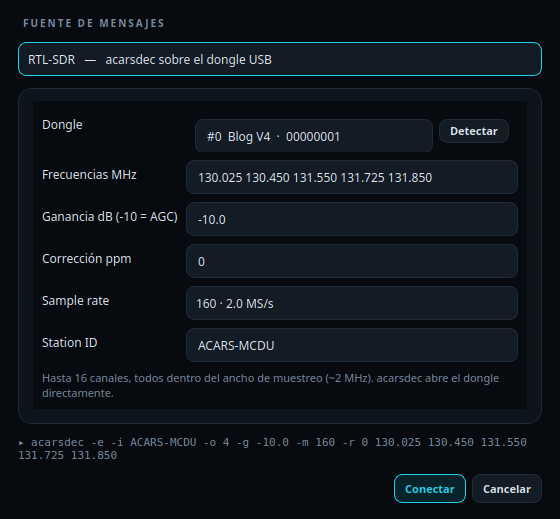

</div>

| Fuente | Para qué | Parámetros |
|---|---|---|
| **RTL-SDR** | dongle USB local; la app lanza `acarsdec` | dongle detectado por librtlsdr (muestra modelo y número de serie), frecuencias, ganancia, ppm, sample rate, station ID |
| **UDP** | recibir de un `acarsdec -j`, local o en otra máquina | IP de escucha (`0.0.0.0` para remoto) y puerto |
| **CMD** | cualquier proceso que imprima el JSON de `acarsdec -o 4` por stdout | línea de comando |
| **SIM** | probar la interfaz sin radio | intervalo entre mensajes |

<div align="center">

| 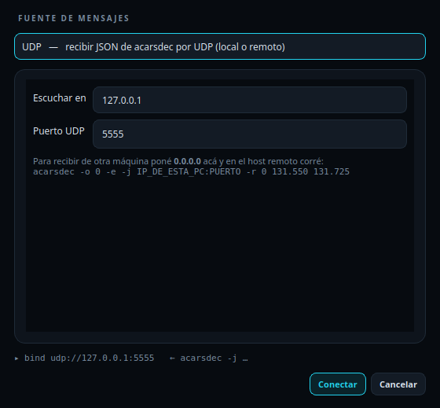 | 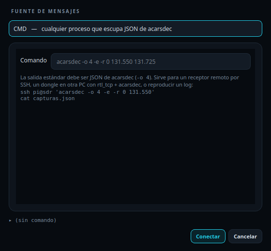 |
|---|---|

</div>

Equivalentes por línea de comandos:

```bash
./start.sh                 # última fuente guardada
./start.sh rtl             # dongle local
./start.sh udp 5555        # escuchar JSON de acarsdec -j
./start.sh cmd "ssh pi@sdr 'acarsdec -o 4 -e -r 0 131.550'"
./start.sh sim             # sin radio
./start.sh split           # acarsdec -j acá + GUI en modo UDP
DEV=1 GAIN=40 PPM=2 FREQS="131.550 131.725" ./start.sh rtl
```

Receptor en otra máquina (una Raspberry con el dongle, por ejemplo):

```bash
# en la Raspberry
acarsdec -o 0 -e -j IP_DE_LA_PC:5555 -r 0 130.025 131.550 131.725
# en la PC: SOURCE → UDP → escuchar en 0.0.0.0, puerto 5555
```

---

## La pantalla MCDU

Pantalla de 24×14 caracteres con los colores de un MCDU real (verde para datos,
cian para enlaces, ámbar para el objetivo, magenta para lo seleccionado por el
piloto automático), seis LSK por lado, teclado alfanumérico y scratchpad.

| Página | Qué muestra |
|---|---|
| `ACARS INDEX` | menú, cantidad de mensajes, objetivo actual y último mensaje recibido |
| `RECEIVED MSGS` | historial paginado: hora, modo+label, frecuencia, errores, nivel, matrícula, vuelo y preview. LSK6R filtra por lo que escribas en el scratchpad |
| `MSG DISPLAY` | mensaje completo con scroll, block ID, MSN, ACK y LSK6R para seguir al avión |
| `FLIGHT DATA` | estado en vivo del objetivo en formato CDU |
| `AIRCRAFT DATA` | matrícula, tipo, fabricante, operador, país, Mode S y ruta |
| `VHF / RECEIVER` | canales en uso y mensajes por canal, fuente y ganancia |
| `ACARS STATUS` | fuente, estado del enlace, totales, tasa por minuto, tráfico visible, último evento |
| `ACARS DOWNLINK` | redacción de downlink **simulada** (el RTL-SDR solo recibe) |
| `ATC REPORT` | reporte de posición armado con los datos en vivo |

| | |
|---|---|
| 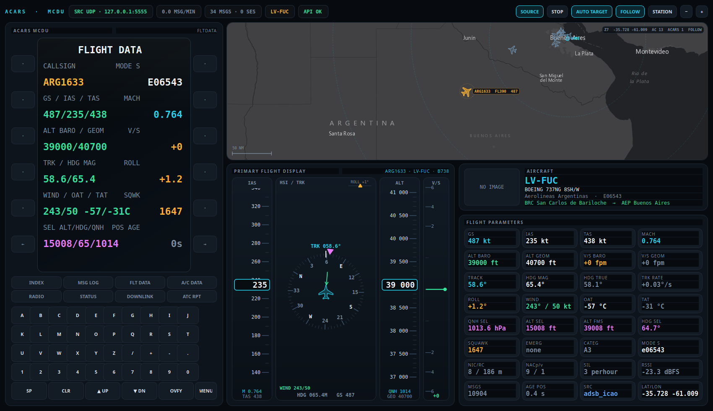 | 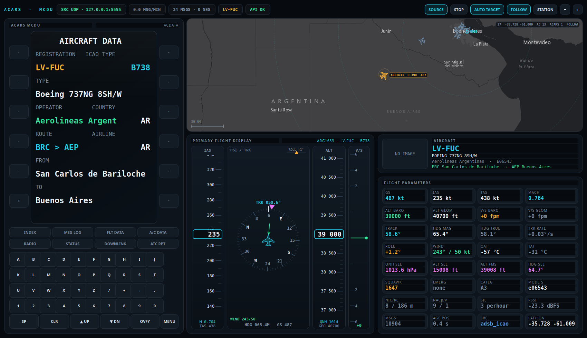 |
| 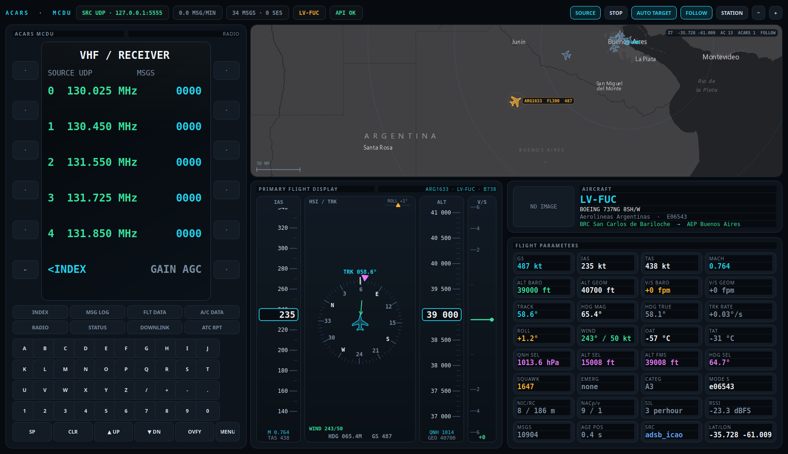 | 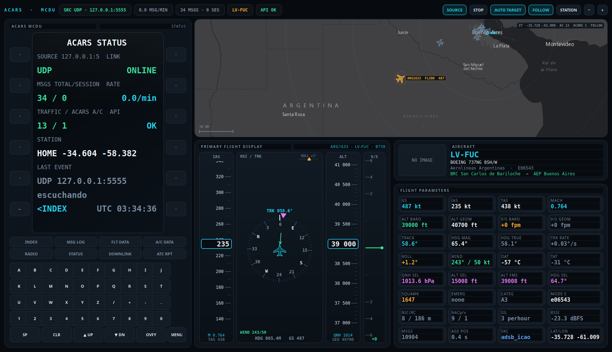 |

---

## Mapa

Mapa raster propio dibujado con `QPainter` — **sin QtWebEngine**, así que el
paquete es chico y no hay un navegador adentro.

- Tiles Esri Dark Gray + capa de etiquetas, cacheados en `~/.cache/acars_mcdu/tiles/`.
- Anillos de alcance configurables desde la estación (100/200/300 NM por defecto).
- Tráfico ADS-B con silueta orientada al track; en cian los aviones de los que se
  oyó ACARS, en ámbar el objetivo, con estela y etiqueta (callsign, FL, GS).
- Arrastrar para mover, rueda para zoom, clic para seleccionar, doble clic para
  centrar. `FOLLOW` sigue al objetivo y `AUTO TARGET` engancha al último avión
  escuchado por ACARS.

---

## PFD y parámetros de vuelo

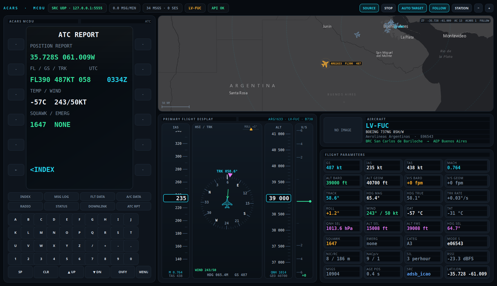

- **Cinta de IAS** con Mach y TAS.
- **HSI** con rosa de rumbos, track, heading magnético, bug de rumbo del piloto
  automático, vector de viento e indicador de alabeo.
- **Cinta de altitud** barométrica con altitud geométrica, QNH seleccionado y bug
  de altitud del MCP/FMS.
- **Variómetro** con escala comprimida ±6000 fpm.
- **Grilla de 32 parámetros**: GS, IAS, TAS, Mach, ALT baro y geom, V/S baro y
  geom, track, headings magnético y verdadero, track rate, roll, viento, OAT,
  TAT, QNH, altitudes y rumbo seleccionados, squawk, emergencia, categoría,
  Mode S, NIC/RC, NACp/v, SIL, RSSI, edad de la posición, fuente y lat/lon.

Los campos sin dato muestran `---`: nada se inventa.

---

## Teclas

| Tecla | Acción |
|---|---|
| `A-Z` `0-9` `/` `+` `-` `.` | escriben en el scratchpad |
| `F1`–`F6` | LSK izquierdas |
| `Shift`+`F1`–`F6` | LSK derechas |
| `↑` `↓` | scroll de lista o de texto del mensaje |
| `Backspace` | CLR |
| `Esc` | volver al índice |
| `Enter` | aplicar filtro (MSG LOG) o encolar downlink |

---

## Configuración

`~/.config/acars_mcdu/config.json`, creado al primer arranque:

```jsonc
{
  "station":  { "name": "HOME", "lat": -34.6037, "lon": -58.3816 },
  "acarsdec": { "bin": "acarsdec", "device": "0", "gain": 40, "ppm": 0,
                "mult": 160, "freqs": [130.025, 130.45, 131.55, 131.725, 131.85],
                "station_id": "ACARS-MCDU" },
  "udp":      { "host": "0.0.0.0", "port": 5555 },
  "source":   { "mode": "udp", "command": "", "sim_interval": 4 },
  "map":      { "zoom": 6, "tiles": "...", "overlay": "...",
                "range_rings_nm": [100, 200, 300] },
  "poll":     { "traffic_sec": 12, "target_sec": 5, "radius_nm": 250 }
}
```

Ritmos de actualización: tráfico de la zona cada `traffic_sec` (12 s), objetivo
seleccionado cada `target_sec` (5 s), barra de estado cada segundo. No bajes
mucho esos valores: las APIs son gratuitas y sin key.

La posición de la estación también se puede pasar con `--lat` / `--lon`; define
el centro de los anillos y de la búsqueda de tráfico.

---

## De dónde salen los datos

| Dato | Fuente | Notas |
|---|---|---|
| Mensajes ACARS | [`acarsdec`](https://github.com/TLeconte/acarsdec) | JSON nativo por UDP (`-j`) o stdout (`-o 4`) |
| Posición y estado en vivo | [api.adsb.lol](https://api.adsb.lol/docs) | feed comunitario, sin API key |
| Matrícula, tipo, operador, ruta, foto | [api.adsbdb.com](https://www.adsbdb.com/) | sin API key, cacheado en SQLite |
| Tiles | Esri Dark Gray Canvas | cacheados en disco |

Flightradar24 no tiene API pública gratuita, por eso no se usa.

El historial queda en `~/.cache/acars_mcdu/acars.db` (SQLite), con el JSON crudo
de cada mensaje, así que se puede consultar aparte:

```bash
sqlite3 ~/.cache/acars_mcdu/acars.db \
  "select datetime(ts,'unixepoch','localtime'), tail, flight, label, freq, level
   from messages order by ts desc limit 20"
```

---

## Construir el AppImage

```bash
./packaging/build-appimage.sh          # dist/ACARS_MCDU-1.0.0-x86_64.AppImage
```

Usa [python-appimage](https://github.com/niess/python-appimage) para una base de
Python 3.12, instala el paquete con PyQt6, poda los módulos Qt que no se usan
(Quick, Qml, Multimedia, 3D, WebEngine…: de 340 MB a 180 MB de AppDir) y empaqueta
con `appimagetool`. Resultado: ~58 MB.

Capturas e icono se regeneran con:

```bash
QT_QPA_PLATFORM=offscreen python3 tools/make_icon.py
QT_QPA_PLATFORM=offscreen python3 tools/make_screenshots.py
```

---

## Estructura del proyecto

```
acars_mcdu/
  main.py          ventana, correlación ACARS ↔ ADS-B, timers, señales
  mcdu.py          widget MCDU: pantalla de 24×14, teclas y páginas
  mapview.py       mapa raster propio + capa de tráfico
  instruments.py   cintas, HSI, variómetro y grilla de parámetros
  source.py        fuentes: RTL-SDR, UDP, comando externo, simulador
  sourcedialog.py  selector de fuente
  lookup.py        clientes adsb.lol y adsbdb (asíncronos, QNetworkAccessManager)
  store.py         SQLite: historial y caché de fichas/rutas
  rtl.py           detección de dongles por librtlsdr (ctypes)
  theme.py         paleta y QSS
tools/             generación de icono, capturas e inyector UDP de prueba
packaging/         AppImage (.desktop + script de build)
start.sh           lanzador
```

---

## Resolución de problemas

**No entra ningún ACARS.** Es normal que pasen minutos sin tráfico. Verificá en
`VHF / RECEIVER` que haya canales y en `ACARS STATUS` que la fuente esté en verde.
Acá 131.725 y 131.550 son las frecuencias activas; con una antena de banda aérea
y ganancia fija en 40 dB (mejor que AGC) deberían entrar mensajes.

**Muchos `ERR` o niveles bajo −28 dB.** Señal justa: subí la ganancia en SOURCE,
mejorá la antena o reducí la cantidad de canales simultáneos.

**"dongle ocupado".** Otro `acarsdec`, `rtl_test` o SDR# está usando el RTL-SDR:
`pkill acarsdec` y reintentá. La app cierra su `acarsdec` al salir, incluso con
SIGTERM.

**El mapa queda gris.** Sin internet no bajan los tiles; el tráfico y las fichas
de avión también dependen de las APIs. Los mensajes ACARS se siguen decodificando
y guardando igual.

**`API ERR` en la barra.** adsb.lol o adsbdb no respondieron; se reintenta en el
siguiente poll. Si es permanente, revisá salida HTTPS.

---

## Licencia

MIT — ver [LICENSE](LICENSE).

ACARS es solo recepción: este software no transmite nada. La página `DOWNLINK`
es una simulación para completar la experiencia de cabina.
